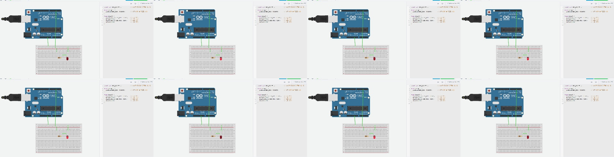
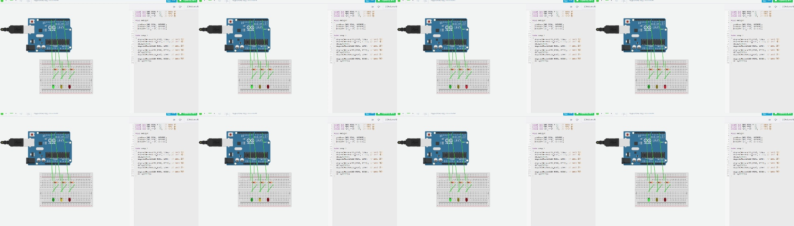
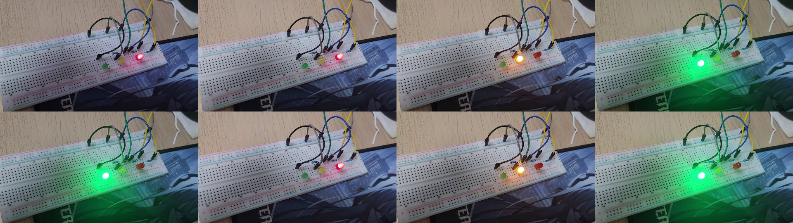
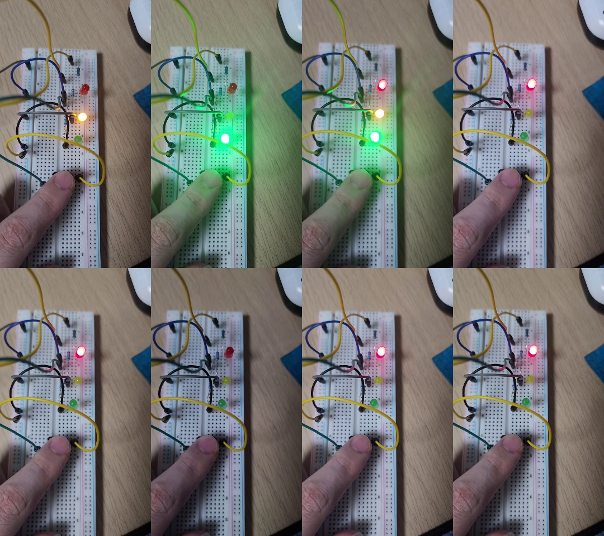

# 아두이노 우노 실습 정리 (2026-10-19)

오늘 아두이노 우노로 실습한 내용을 정리했습니다. LED 출력부터 시작해서 가변저항(아날로그 입력), 버튼(디지털 입력), `millis()`, 인터럽트, PWM, 네오픽셀까지 다뤘습니다.

모든 스케치는 `arduino-cli`로 Arduino Uno(`arduino:avr:uno`)용 컴파일을 통과했습니다. 각 폴더를 Arduino IDE에서 열면 바로 업로드할 수 있습니다.

## 실습 영상 캡처

| Tinkercad: LED Blink | Tinkercad: 3색 신호등 |
|---|---|
|  |  |

| 실제 회로: 신호등 (빨강 → 노랑 → 초록) |
|---|
|  |

| 실제 회로: 버튼 인터럽트 신호등 (누르면 전체 켜짐) |
|---|
|  |

## 스케치 목록

| # | 폴더 | 내용 | 핀 |
|---|---|---|---|
| 1 | [01_Blink](01_Blink/01_Blink.ino) | 내장 LED 깜빡이기 (1초 / 0.1초) | D13 |
| 2 | [02_Blink_A0](02_Blink_A0/02_Blink_A0.ino) | 아날로그 핀을 디지털 출력으로 사용 | A0 |
| 3 | [03_Blink_D3](03_Blink_D3/03_Blink_D3.ino) | 외부 LED 켜고 끄기 | D3 |
| 4 | [04_LED_Sequence](04_LED_Sequence/04_LED_Sequence.ino) | LED 3개 차례로 켜기 (디버깅) | D3, D8, D10 |
| 5 | [05_Siren](05_Siren/05_Siren.ino) | LED 2개 경찰차 사이렌 | D3, D8 |
| 6 | [06_Pot_Read](06_Pot_Read/06_Pot_Read.ino) | 가변저항 값 시리얼 출력 | A5 |
| 7 | [07_Pot_Two](07_Pot_Two/07_Pot_Two.ino) | 가변저항 2개 읽기 | A4, A5 |
| 8 | [08_Button_Read](08_Button_Read/08_Button_Read.ino) | 버튼 상태 읽기 (`INPUT_PULLUP`) | A0 |
| 9 | [09_Button_Count](09_Button_Count/09_Button_Count.ino) | `millis()` 디바운스로 누른 횟수 세기, 5번마다 LED 토글 | A0, A5 |
| 10 | [10_Button_Gesture](10_Button_Gesture/10_Button_Gesture.ino) | 더블클릭 → 켜기, 길게 → 끄기, 한 번 → 무시 | A0, A5 |
| 11 | [11_Interrupt_Toggle](11_Interrupt_Toggle/11_Interrupt_Toggle.ino) | 인터럽트(`CHANGE`)로 누를 때/뗄 때 토글 | D2, A5 |
| 12 | [12_Traffic_Interrupt](12_Traffic_Interrupt/12_Traffic_Interrupt.ino) | 신호등 + 인터럽트 전체 켜기 (초록 5초/노랑 2초/빨강 5초) | D7–D9, D2 |
| 13 | [13_Pot_LED_PWM](13_Pot_LED_PWM/13_Pot_LED_PWM.ino) | 가변저항으로 LED 밝기 조절 (PWM) | A0, D9 |
| 14 | [14_NeoPixel_Gauge](14_NeoPixel_Gauge/14_NeoPixel_Gauge.ino) | 가변저항으로 네오픽셀 8구 게이지 | A0, D10 |
| 15 | [15_Traffic_Light](15_Traffic_Light/15_Traffic_Light.ino) | 신호등 빨강 → 노랑 → 초록 2초씩 | D7–D9 |
| 16 | [16_Traffic_Light_Interrupt](16_Traffic_Light_Interrupt/16_Traffic_Light_Interrupt.ino) | 신호등 + 버튼 인터럽트 (최종) | D7–D9, D2 |

## 배운 내용 요약

### 1. 디지털 출력 — LED
- `pinMode(핀, OUTPUT)`으로 출력 설정, `digitalWrite(핀, HIGH/LOW)`로 켜고 끄기.
- 보드 내장 LED는 `LED_BUILTIN`(D13).
- A0~A5 아날로그 핀도 디지털 출력으로 쓸 수 있음.
- 결선: **핀 → 220Ω 저항 → LED 긴 다리(+)**, **LED 짧은 다리(−) → GND**.
- 핀 번호는 `const int LED_PIN = 3;`처럼 상수로 선언하면 바꾸기 쉬움.

### 2. 코드 디버깅에서 찾은 실수
- 문장 끝 **세미콜론(`;`) 누락** → 컴파일 오류.
- 켠 LED를 `LOW`로 **끄지 않으면** 다음 반복에서도 계속 켜져 있음.
- 주석이 실제 코드와 다르면 헷갈리므로 같이 고치기.

### 3. 아날로그 입력 — 가변저항
- `analogRead(A0)` → 0~5V를 **0~1023**으로 읽음.
- 전압 변환: `value * (5.0 / 1023.0)`.
- 결선: **바깥 다리 5V / 가운데 다리 아날로그 핀 / 다른 바깥 다리 GND**.
- `Serial.begin(9600)` + `Serial.print()`로 시리얼 모니터에 출력 (속도 9600 baud).
- A4, A5는 I2C(SDA, SCL) 핀이기도 해서 I2C 장치와 같이 쓰면 충돌.

### 4. 디지털 입력 — 버튼
- `INPUT_PULLUP`: 내부 풀업 저항 사용 → **안 누르면 HIGH, 누르면 LOW**. 결선은 **핀 ↔ 버튼 ↔ GND**만 하면 됨.
- 4발 택트 버튼은 같은 쪽 다리가 내부에서 붙어 있으므로 **대각선 다리**를 쓰면 확실함.

### 5. `millis()`와 현재값/과거값 비교
- `delay()`는 그동안 아무것도 못 하지만, `millis()`로 시간을 재면 `loop()`가 멈추지 않음.
- **현재값 ≠ 과거값**이면 바뀐 시각을 기록하고, 일정 시간(50ms) 그대로면 진짜 변화로 인정 → **디바운스(채터링 제거)**.
- **HIGH → LOW로 바뀐 순간**만 세면 꾹 눌러도 1번으로 셈.
- `pressCount % 5 == 0`으로 5번마다 동작.
- 누른 시간과 뗀 시간 간격으로 **더블클릭 / 길게 누르기 / 한 번 누르기** 구분.

### 6. 인터럽트
- 우노의 외부 인터럽트 핀은 **D2, D3 두 개뿐**.
- `attachInterrupt(digitalPinToInterrupt(2), 함수, 모드)`
  - `FALLING`: 누르는 순간, `RISING`: 떼는 순간, `CHANGE`: 둘 다.
- 인터럽트와 `loop()`가 같이 쓰는 변수는 **`volatile`**.
- 인터럽트 함수는 짧게: `Serial` 출력은 플래그만 세우고 `loop()`에서 처리.
- 신호등에 인터럽트를 넣을 때는 `delay()` 대신 `millis()`로 바꿔야 전체 켜기가 바로 풀리지 않음.
- 최종 신호등: 버튼 → 전체 켜짐 → 다시 버튼 → **전부 꺼짐(1초) → 빨강부터 다시 시작**.

### 7. 아날로그 출력 — PWM
- `analogWrite(핀, 0~255)`로 밝기 조절. `~` 표시가 있는 **PWM 핀(3, 5, 6, 9, 10, 11)** 에서만 동작.
- `map(값, 0, 1023, 0, 255)`로 입력 범위를 출력 범위로 변환.

### 8. 네오픽셀
- 라이브러리: **Adafruit NeoPixel** (라이브러리 매니저에서 설치).
- `setPixelColor()`로 색을 정하고 **`show()`를 해야 실제로 표시**됨.
- `map(potValue, 0, 1024, 0, 9)`처럼 범위를 나누면 0~8칸이 고르게 나뉨.
- USB 전원에서는 `setBrightness(50)` 정도로 밝기를 낮춰 사용.
